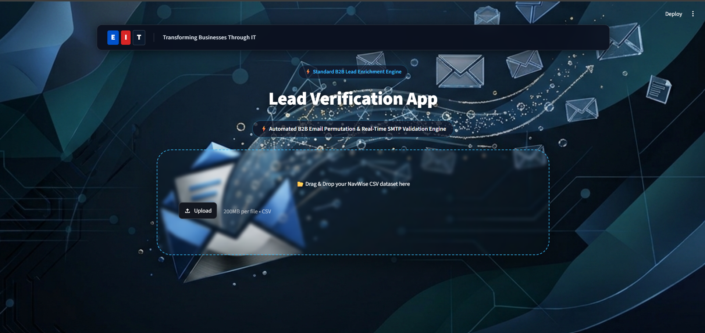

<div align="center">

# ⚡ EIT LEAD VERIFICATION APP

### _Intelligent B2B Lead Enrichment & Email Verification Engine_

[](https://www.python.org/)
[](https://streamlit.io/)
[](https://openpyxl.readthedocs.io/)
[](https://www.dnspython.org/)
[](https://docs.python.org/3/library/smtplib.html)
[](https://developers.google.com/custom-search/v1/overview)
[](https://pandas.pydata.org/)
[](https://openpyxl.readthedocs.io/)

**Transforming Businesses Through IT**

An automated B2B lead enrichment platform that generates corporate email permutations, performs DNS and SMTP-based email checks, discovers publicly available contact numbers, and exports structured lead reports into professionally formatted Excel files.

</div>

---

## 📖 Overview

The **EIT Lead Verification App** is a Python-based lead enrichment and verification tool designed to simplify the process of preparing B2B prospect data for sales and outreach teams.

Built with **Streamlit**, the application combines intelligent email pattern generation, mail-server checks, phone number discovery through Google Custom Search, and automated Excel report generation into one interface.

Instead of manually checking contact information, users can upload a CSV dataset, start the verification workflow, monitor progress, and download the resulting Excel report.

### 🎯 Project Objectives

- Automate corporate email address permutation generation.
- Identify domain mail servers through DNS MX record lookups.
- Perform SMTP-based mailbox verification attempts where supported by the receiving server.
- Discover potentially relevant business contact numbers through Google Custom Search.
- Export enriched lead data into a clean, professionally formatted Excel workbook.
- Provide a modern interface with progress tracking and execution status updates.

---

## 📸 Application Preview

<div align="center">



_EIT Lead Verification App — Streamlit interface_

</div>

---

## ✨ Core Features

### 📧 1. Smart Email Permutations

Automatically generates commonly used corporate email patterns from first names, last names, and company domains.

**Example patterns:**

| Pattern                   | Example                |
| :------------------------ | :--------------------- |
| First name + last name    | `john.doe@company.com` |
| First initial + last name | `jdoe@company.com`     |
| First name only           | `john@company.com`     |
| First name + last initial | `jdo@company.com`      |

Generated addresses are candidate permutations. Their existence and deliverability must be evaluated separately.

### 🌐 2. DNS MX Record Lookup

Uses **Dnspython** to query DNS MX records and identify the mail servers associated with a target domain.

- Identifies domains configured to receive email.
- Helps determine whether a domain has mail-routing records.
- Provides an initial check before attempting SMTP verification.

### 🔍 3. SMTP-Based Email Verification

Uses Python's SMTP and socket libraries to attempt communication with mail servers where connections are permitted.

The application can classify verification results according to its implemented checks, such as:

- **Valid:** The server returned a response consistent with the application's acceptance criteria.
- **Greylisted:** The server temporarily deferred the request.
- **Invalid:** The server returned a response classified as invalid by the application's checks.

> **Important:** SMTP acceptance does not guarantee that a mailbox exists or that an email will be delivered. Some mail servers reject verification probes, accept all addresses, or block external SMTP connections. Treat these results as indicators rather than definitive proof of deliverability.

### 📱 4. Direct Phone Number Discovery

Integrates with the **Google Custom Search API** to search for publicly available contact information associated with target businesses and prospects.

- Searches indexed web content for relevant phone numbers.
- Filters out general company switchboards where the implemented rules can identify them.
- Helps identify potentially relevant direct business contact numbers.

> Search results may contain outdated, shared, or incorrectly associated numbers. Review discovered contact details before using them for outreach.

### 📊 5. Automated Excel Report Generation

Uses **OpenPyXL** to generate professionally formatted `.xlsx` reports.

- Custom header styling and cell formatting.
- Consistent data fonts and presentation.
- Automatically adjusted column widths.
- Structured output for reviewing enriched leads.
- Downloadable Excel report through the Streamlit interface.

### 🖥️ 6. Modern Streamlit Interface

The application provides a custom interface designed to simplify the verification workflow.

- Branded interface with a glassmorphic visual style.
- Background wallpaper support.
- Live progress indicators.
- Execution status updates and estimated completion time, where implemented.
- CSV upload and Excel report download.

---

## 🛠️ Technology Stack

<div align="center">

| Component                     | Technology               |
| :---------------------------- | :----------------------- |
| **Programming Language**      | Python 3.8+              |
| **Frontend / User Interface** | Streamlit                |
| **Data Input**                | CSV                      |
| **DNS Resolution**            | Dnspython                |
| **Email Verification**        | `smtplib`, `socket`      |
| **Phone Discovery**           | Google Custom Search API |
| **HTTP Requests**             | Requests                 |
| **Excel Report Generation**   | OpenPyXL                 |
| **Configuration & Secrets**   | Streamlit Secrets        |
| **Output Format**             | Excel `.xlsx`            |

</div>

---

## 🏗️ Application Workflow

The application follows a lead enrichment pipeline, from CSV upload to Excel export.

<div align="center">

```text
       ┌─────────────────────────┐
       │     Upload Lead CSV     │
       └────────────┬────────────┘
                    │
                    ▼
       ┌─────────────────────────┐
       │   Read Lead Information │
       │ Names, Company, Website │
       └────────────┬────────────┘
                    │
                    ▼
       ┌─────────────────────────┐
       │  Generate Email Patterns│
       └────────────┬────────────┘
                    │
                    ▼
       ┌─────────────────────────┐
       │    DNS MX Lookup        │
       └────────────┬────────────┘
                    │
                    ▼
       ┌─────────────────────────┐
       │ SMTP Verification Check │
       └────────────┬────────────┘
                    │
                    ▼
       ┌─────────────────────────┐
       │ Phone Discovery via API │
       └────────────┬────────────┘
                    │
                    ▼
       ┌─────────────────────────┐
       │ Format Excel Workbook   │
       └────────────┬────────────┘
                    │
                    ▼
       ┌─────────────────────────┐
       │ Download Verified Leads │
       └─────────────────────────┘
```

</div>

---

## 🚀 Getting Started

### 1. Prerequisites

Ensure the following software is installed on your system:

- **Python 3.8 or later**
- **pip** package manager
- **Git**
- A Google Custom Search API key and Search Engine ID if you intend to use phone discovery.

### 2. Clone the Repository

```bash
git clone https://github.com/faizal08/lead-verification-app.git
cd lead-verification-app
```

### 3. Install Dependencies

Install the required Python libraries:

```bash
pip install streamlit openpyxl dnspython requests
```

Alternatively, if your repository includes a `requirements.txt` file, install dependencies using:

```bash
pip install -r requirements.txt
```

### 4. Configure API Credentials

Create or update the following file in your project root:

`.streamlit/secrets.toml`

Add your Google Custom Search credentials:

```toml
GOOGLE_API_KEY = "your_google_api_key_here"
SEARCH_ENGINE_ID = "your_custom_search_engine_id_here"
```

Replace the placeholder values with your actual credentials.

> 🔐 **Security:** Never commit real API keys or secrets to a public repository. Keep `.streamlit/secrets.toml` out of version control and use Streamlit Secrets or environment-based configuration when deploying the application.

### 5. Run the Application

From the project root, execute:

```bash
python -m streamlit run app.py
```

Streamlit will provide a local URL in the terminal. Open that URL in your browser to access the application.

---

## 💡 How to Use

1. **Prepare your dataset:** Create a CSV file containing the lead information required by the application.
2. **Upload the CSV:** Import your target dataset through the Streamlit interface.
3. **Start verification:** Click **🚀 Start Verification Process**.
4. **Monitor progress:** Follow the progress indicators, status logs, and estimated time remaining where available.
5. **Review the results:** Check the generated email permutations, verification statuses, and discovered phone numbers.
6. **Export the report:** Download the formatted Excel workbook for further review.

### 📄 Expected Input Data

The application is designed to work with lead datasets containing fields such as:

| Column                 | Description                        | Example               |
| :--------------------- | :--------------------------------- | :-------------------- |
| `First Name`           | Prospect's first name              | `John`                |
| `Last Name`            | Prospect's last name               | `Doe`                 |
| `Organisation Name`    | Company or organization name       | `Example Ltd`         |
| `Organisation Website` | Company's website or domain source | `https://example.com` |

> **Note:** The column names above describe the expected input format. Ensure they match the column names accepted by your implementation.

---

## ⚙️ Configuration & Secrets Management

The Google Custom Search integration requires valid credentials and an appropriately configured search engine.

| Setting            | Purpose                                                |
| :----------------- | :----------------------------------------------------- |
| `GOOGLE_API_KEY`   | Authenticates requests to the Google Custom Search API |
| `SEARCH_ENGINE_ID` | Identifies the configured Custom Search Engine         |

### Configuration File Location

```text
lead-verification-app/
├── .streamlit/
│   └── secrets.toml
├── app.py
├── email_verification_wallpaper.png
├── lead_verification_app_screenshot.png
├── README.md
└── requirements.txt
```

The `.streamlit/secrets.toml` file is used for local Streamlit secrets configuration. For deployed applications, configure secrets through the deployment platform.

---

## 📦 Project Structure

```text
lead-verification-app/
│
├── .streamlit/
│   └── secrets.toml
│
├── app.py
├── email_verification_wallpaper.png
├── lead_verification_app_screenshot.png
├── README.md
├── requirements.txt
└── verified_lead_*.xlsx
```

_Note: Generated Excel files may be present locally after running the application. Avoid committing sensitive lead data or generated reports containing personal information._

---

## 📈 Expected Benefits

- **Reduced manual effort:** Automates repetitive email-pattern generation and contact research.
- **Faster lead preparation:** Combines multiple enrichment steps in one workflow.
- **Consistent reporting:** Produces structured Excel output for review and follow-up.
- **Improved visibility:** Provides progress and status information during processing.
- **Reusable workflow:** Supports repeated enrichment of appropriately structured CSV datasets.

---

## 🔒 Responsible Data Usage

This application is intended to assist with legitimate business contact research and lead management.

- Use publicly available and appropriately sourced business contact information.
- Follow the Google API terms and usage limits.
- Respect applicable privacy laws, anti-spam regulations, and opt-out requests.
- Protect API credentials and exported lead data.
- Do not treat SMTP responses as guaranteed evidence of mailbox existence or email deliverability.

---

## 📚 Documentation & Resources

- [Python Documentation](https://docs.python.org/3/)
- [Streamlit Documentation](https://docs.streamlit.io/)
- [OpenPyXL Documentation](https://openpyxl.readthedocs.io/)
- [Dnspython Documentation](https://www.dnspython.org/)
- [Google Custom Search JSON API](https://developers.google.com/custom-search/v1/overview)
- [Requests Documentation](https://requests.readthedocs.io/)
- [Python SMTP Documentation](https://docs.python.org/3/library/smtplib.html)

---

## 📧 Contact

- **Developer:** [Faizal](https://github.com/faizal08)
- **Email:** [reachfaizal08@gmail.com](mailto:reachfaizal08@gmail.com)
- **Repository:** [EIT Lead Verification App](https://github.com/faizal08/lead-verification-app)

---

<div align="center">

### ⚡ EIT Lead Verification App

_Automating B2B Lead Enrichment Through Intelligent Verification._

**Built with Python & Streamlit**

</div>
